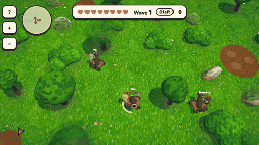

# Kingsmeadow Siege

A cute 3D cannon battler for the browser, made for **GitHub Game Off 2026** (theme: SHIFT).

**Play it:** https://zam-gaming.itch.io/kingsmeadow-siege

Drive a tiny toon cannon around an island, hide in bushes, take cover behind rocks and knock out every rival cannon. After each wave you pick an upgrade.

## Modes
- **Story:** six islands, 24 levels and a boss on every island.
- **Waves:** endless, with a boss every fifth wave.
- **Siege:** defend the keep or storm ever-bigger castles with two allies. Endless, and it keeps getting harder.
- **Daily:** one island, the same for everyone, every day.

Every mode has a global ranking.

## Controls
- **Phone:** drag the left side to drive, tap or drag the right side to fire.
- **Desktop:** WASD or arrows to drive, click or swipe to fire.

## Tech
A single HTML file (`index.html`) using [Three.js](https://threejs.org). Music and sound effects are synthesized in the browser with the Web Audio API. Rankings run on a small Supabase edge function.

Made by zam_gaming with the help of AI (Claude).

## License
Copyright (c) 2026 zam_gaming. All rights reserved. The source is shared for Game Off judging and learning; please don't redistribute or sell it.
